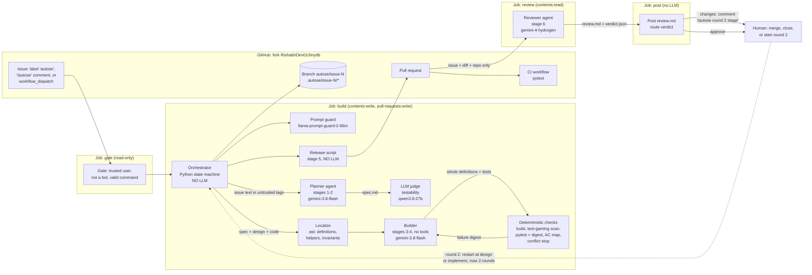

# Component view

This is the full view. Figure 1 in `report.pdf` is a simplified drawing of the same design: it merges the gate, post and CI steps into fewer boxes so it fits on one page. The dashed arrow from the human back to the orchestrator is the review round 2, which restarts at Design or Implement.

Two repositories are involved:

| Repo | Contents | Why separate |
|---|---|---|
| **Fork** `tinydb` (pinned at `edff96a`) | `.github/workflows/autose.yml`, `autose/` (orchestrator, agents, prompts, tools), `ARCHITECTURE.md`, `skills/spec-writer/` | The workflow must live where it runs. |
| **Submission repo** `autose-a3` | report, ADRs, views, issues, **hidden tests**, seeded PRs, results | Hidden tests must never be visible to the agents. If they lived in the fork, the builder could read them. |

Two more workflows reuse these parts for evaluation, and both are started by hand only:
- `autose-review.yml` runs the reviewer on any PR, with its code from master. It is used for the seeded PRs and E1 (ADR-027).
- `autose-e2.yml` runs the builder alone with a frozen spec and design (E2, ADR-028).

Providers: Gemini API, paid Tier 1, for the planner, builder and reviewer; Groq, free tier, for the judge, the prompt guard and the fallback models.

## Tools per agent

The planner and reviewer run on one small in-house tool loop (`autose/agent.py`)
over OpenAI-compatible chat APIs (Gemini, Groq). Each gets an explicit allow-list of
Python functions; anything not on the list does not exist for it. Since
ADR-016, the builder has **no tools**. The orchestrator gives it the code it
needs (`autose/patcher.py`), and it answers once per attempt.

| Agent | Tools | Cannot |
|---|---|---|
| Planner | `read_file`, `list_dir`, `grep`, `write_artifact` (only `.autose/`) | edit source, run shell, use network |
| LLM judge | none (single completion, JSON out) | anything |
| Builder | none (ADR-016). It receives the definitions the design names and answers with whole replacement definitions and one new test file. The orchestrator applies them by name, only to `tinydb/*.py` and `tests/test_autose_issue_N.py`, then runs the fixed pytest command. (`BUILDER_MODE=agent` restores the earlier tool loop: `read_file`, `grep`, `replace_lines`, `edit_file`, `write_file`, `run_tests`.) | read files on its own, write outside those paths, push, call `gh`, run shell, read secrets |
| Reviewer | `read_file`, `list_dir`, `grep`, `run_tests` | write any file, push, comment (its job token is read-only) |
| Orchestrator / release / post | `git`, `gh` CLI | — (code, not an LLM) |
