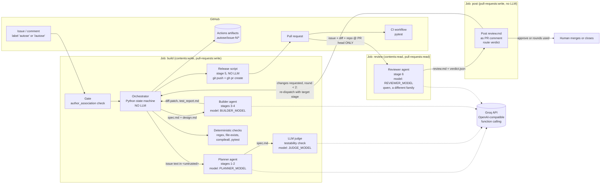

# Component view

Two repositories are involved:

| Repo | Contents | Why separate |
|---|---|---|
| **Fork** `tinydb` (pinned at `edff96a`) | `.github/workflows/autose.yml`, `autose/` (orchestrator, agents, prompts, tools), `ARCHITECTURE.md`, `skills/spec-writer/` | The workflow must live where it runs. |
| **Submission repo** `autose-a3` | report, ADRs, views, issues, **hidden tests**, seeded PRs, results | Hidden tests must never be visible to the agents. If they lived in the fork, the builder could read them. |

## Tools per agent

The planner and reviewer run on one small in-house tool loop (`autose/agent.py`)
over Groq's OpenAI-compatible chat API. Each gets an explicit allow-list of
Python functions; anything not on the list does not exist for it. Since
ADR-016, the builder has **no tools**. The orchestrator gives it the code it
needs (`autose/patcher.py`), and it answers once per attempt.

| Agent | Tools | Cannot |
|---|---|---|
| Planner | `read_file`, `list_dir`, `grep`, `write_artifact` (only `.autose/`) | edit source, run shell, use network |
| LLM judge | none (single completion, JSON out) | anything |
| Builder | none (ADR-016). It receives the definitions the design names and answers with whole replacement definitions and one new test file. The orchestrator applies them by name, only to `tinydb/*.py` and `tests/test_autose_issue_N.py`, then runs the fixed pytest command. (`BUILDER_MODE=agent` restores the earlier tool loop: `read_file`, `grep`, `replace_lines`, `edit_file`, `write_file`, `run_tests`.) | read files on its own, write outside those paths, push, call `gh`, run shell, read secrets |
| Reviewer | `read_file`, `list_dir`, `grep`, `run_tests` | write any file, push, comment (its job token is read-only) |
| Orchestrator / release / post | `git`, `gh` CLI | — (code, not an LLM) |
