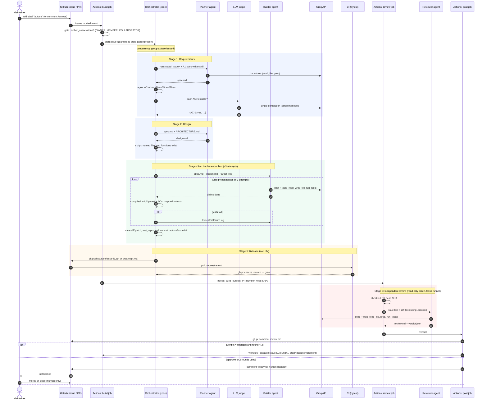

# Sequence view: one run, from trigger to review

> **Status: PLANNED.** The diagram below shows the designed message flow. Every `⟨…⟩` placeholder will be filled in from **one real run** after it happens: the run URL, PR number, timestamps, attempts and tokens. Values are copied from that run's `state.json` and its Actions log. Nothing here will be invented.

## Run record (filled in from the real run)

| Field | Value |
|---|---|
| Issue | ⟨#N title⟩ |
| Trigger | ⟨label `autose` / comment `/autose`⟩ by ⟨user⟩ at ⟨time⟩ |
| Build job run | ⟨https://github.com/…/actions/runs/…⟩ |
| Review job run | ⟨url⟩ |
| PR | ⟨#M url⟩ |
| Implement/test attempts | ⟨n⟩ |
| Review rounds | ⟨n⟩, final verdict ⟨approve / changes⟩ |
| Tokens (planner / judge / builder / reviewer) | ⟨…⟩ |
| Wall-clock time | ⟨mm:ss⟩ |

## Diagram

