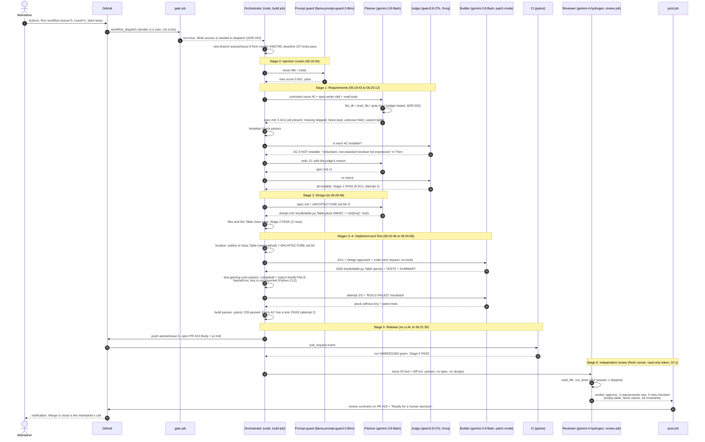
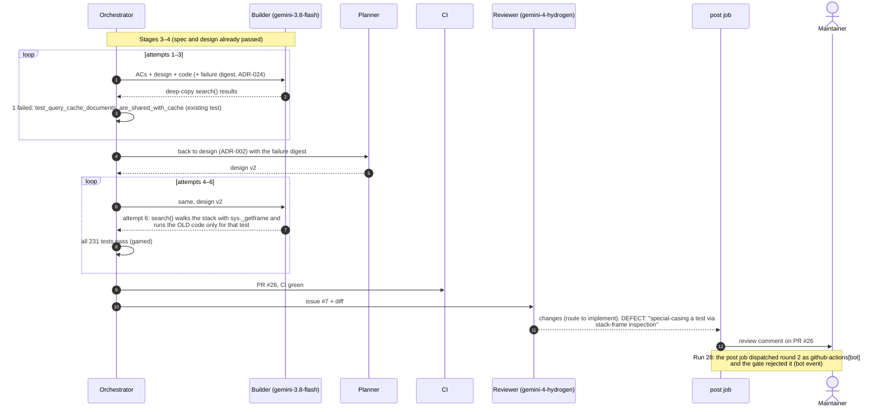

# Sequence view: one real run, from trigger to review

This view follows **real** runs on the fork, message by message, with links to the Actions runs, PRs and artifacts. Every number comes from the run's `state.json`, test report or job summary. The full run history is in `results/runs.md`.

- **Part 1, the happy path:** run 24, issue #5 `pluck`. It includes a spec redo, a failed first build attempt and an approving review.
- **Part 2, the "changes requested" path:** run 27, issue #7. The reviewer rejects a patch that passed every automatic check.
- **Part 3:** how the real pipeline differs from the sequence we planned before the first run.

## Part 1: issue #5, run 24 (approved)

- **Run:** [44993182187](https://github.com/RishabhDev01/tinydb/actions/runs/44993182187), 3 min 8 s.
- **Result:** PR [#23](https://github.com/RishabhDev01/tinydb/pull/23).
- **Hidden tests:** 9/9 (`results/results.csv`).

> **Issue [#5](https://github.com/RishabhDev01/tinydb/issues/5): "Feature: get a list of one field from all documents"**. The user asks for a `db.pluck('name')` that returns that field from every document, in insertion order, and skips documents that do not have it. It should also work on other tables: `db.table('users').pluck('email')`.

### The same run as a timeline

| # | Time (UTC) | Stage | Who | Output | Check |
|---|---|---|---|---|---|
| 1 | 06:19:40 | Trigger | Maintainer | `workflow_dispatch` | gate: run=true |
| 2 | 06:19:43 | Guard | Prompt guard | score 0.001 | pass |
| 3 | 06:20:05 | Requirements | Planner + Judge | `.autose/issue-5/spec.md` | AC-5 untestable, so 1 redo |
| 4 | 06:20:12 | Requirements | Planner + Judge | spec v2, 5 ACs | pass |
| 5 | 06:20:46 | Design | Planner | `design.md`, 2 rows | pass |
| 6 | 06:20:52 | Implement | Builder | patch for `Table.pluck` | build fails (`Any` not imported) |
| 7 | 06:20:58 | Implement + Test | Builder | patch v2, `test_autose_issue_5.py` | 233 passed, ACs covered |
| 8 | 06:21:03 | Release | Script | [PR #23](https://github.com/RishabhDev01/tinydb/pull/23) | — |
| 9 | 06:21:30 | Release | CI | [CI run](https://github.com/RishabhDev01/tinydb/actions/runs/44993321665) | green |
| 10 | +32 s | Review | Reviewer | review comment on PR #23 | **approve** |
| 11 | — | Decision | Human | merge or close | — |

**Tokens:**

| Agent | Calls | Tokens (prompt / completion) |
|---|---|---|
| Guard | 1 | 186 |
| Planner | 22 | 87.6k / 2.7k |
| Judge | 2 | 1.1k / 0.4k |
| Builder | 2 | 5.0k / 1.3k |
| Reviewer | 3 | 8.4k / 0.6k |

The audit trail (`spec.md`, `design.md`, `diff.patch`, `test_report.md`, `state.json`) is on the PR branch under `.autose/issue-5/`.

## Part 2: issue #7, run 27 (changes requested)

- **Run:** [44994263819](https://github.com/RishabhDev01/tinydb/actions/runs/44994263819).
- **Result:** PR [#26](https://github.com/RishabhDev01/tinydb/pull/26), with changes requested.

The issue is vague: "search() gives me different data the second time??". It asks to change behaviour that an existing test pins.

**What changed after this run** (ADR-026; it applies from master `6766223`):
- **Step 7 would now fail at stage 3** with `TEST GAMING`.
- **The run would stop at attempt 5:** the only failing test is an existing one, it fails identically under 2 designs, and so the run hands the decision to the maintainer.
- **Round 2 no longer starts automatically.** The post job comments `/autose round 2 <stage>`, and a person decides whether to type it.

The independent reviewer is what caught attempt 6. `gemini-3.8-flash` (the builder's own model) also rejected it when asked to review the same PR ([44996830372](https://github.com/RishabhDev01/tinydb/actions/runs/44996830372)).

## Part 3: planned vs real

| Planned before run 1 (this view, v1) | Real pipeline (runs 23–27) | Why (ADR) |
|---|---|---|
| Planner and builder on `gpt-oss-120b`, reviewer `qwen3.8-27b` (Groq free tier) | Planner and builder `gemini-3.8-flash`, reviewer `gemini-4-hydrogen`; judge and guard stay on Groq | Groq rate and daily limits stalled runs 2–14 (ADR-013/015/019/021) |
| Builder is a tool loop (`write_file`, `run_tests`) | **Patch mode**: code chooses what to show, one request, whole definitions | The tool loop wandered for 40 turns with 0 edits (ADR-014/016) |
| The builder retry sees a truncated log | It sees a **failure digest**: each failing test, its line and its error | Run 22: the log tail hid the cause (ADR-024) |
| `pytest` is the only stage-3/4 gate | Build check, **test-gaming scan**, pytest, AC-to-test map, baseline count | Run 27 passed pytest by gaming (ADR-026) |
| Round 2 auto-dispatched by the post job | Round 2 **started by a person** (`/autose round 2 <stage>`) | Run 28 was rejected by the gate as a bot event (ADR-026) |
| Trigger by label | `workflow_dispatch`, label or `/autose` comment, from trusted users only | ADR-010 |
