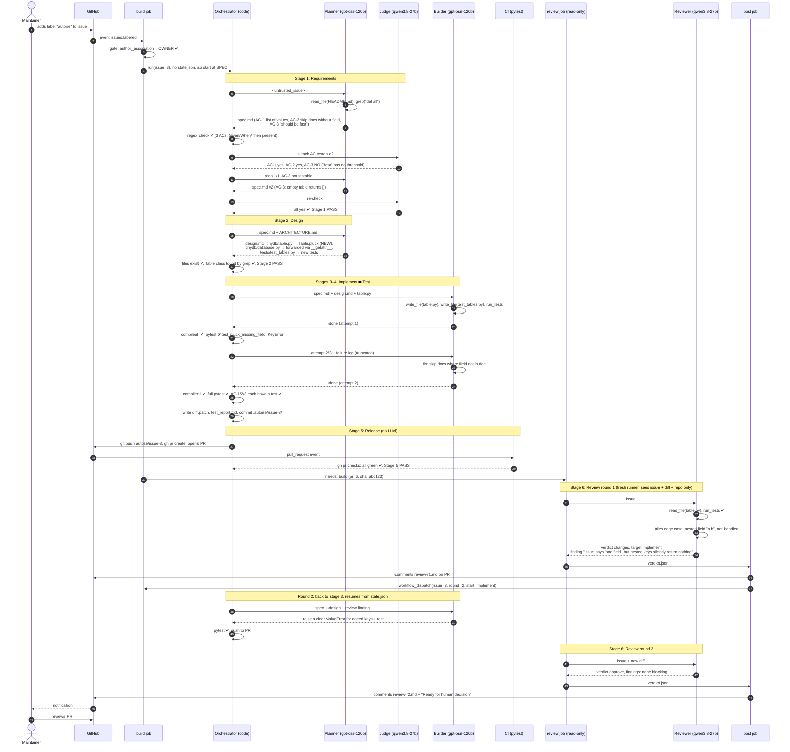

# Sequence view: what one run looks like, from trigger to review

This walk-through follows one issue through the whole workflow, message by message. It shows the concrete inputs and outputs at every hop, including a test retry and one review round that sends work back. Links to actual Actions runs are listed in `results/runs.md`.

**Example issue: #3 "Feature: get a list of one field from all documents"**

> I often need just the `name` of every document. Right now I write
> `[d['name'] for d in db.all()]`, which breaks when some docs have no `name`.
> Could tinydb have something like `db.pluck('name')`?

## The same run as a timeline

| Step | Stage | Who | Output on GitHub | Check result |
|---|---|---|---|---|
| 1 | Trigger | Maintainer | label `autose` on issue #3 | gate ✔ |
| 2 | Requirements | Planner + Judge | `.autose/issue-3/spec.md` | 1 redo (AC-3 untestable), then ✔ |
| 3 | Design | Planner | `design.md` | files and functions exist ✔ |
| 4 | Implement | Builder | `diff.patch` | builds ✔ |
| 5 | Test | Builder | `test_report.md` | attempt 1 ✘, attempt 2 ✔ |
| 6 | Release | Script | PR #6 + `pr.md` | CI green ✔ |
| 7 | Review r1 | Reviewer | PR comment `review-r1.md` | changes → implement |
| 8 | Implement/Test r2 | Builder | new commit on PR #6 | pytest ✔, CI ✔ |
| 9 | Review r2 | Reviewer | PR comment `review-r2.md` | approve |
| 10 | Decision | Human | merge or close | — |
